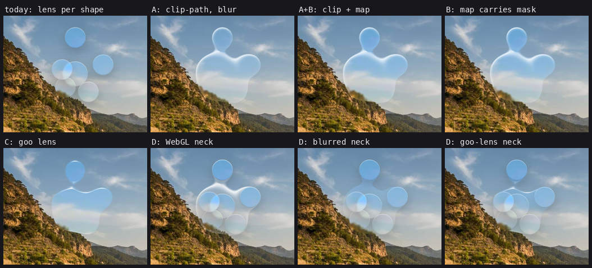
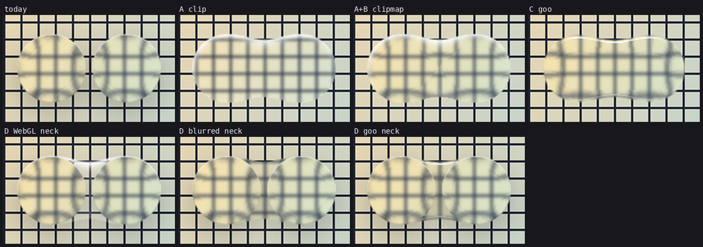
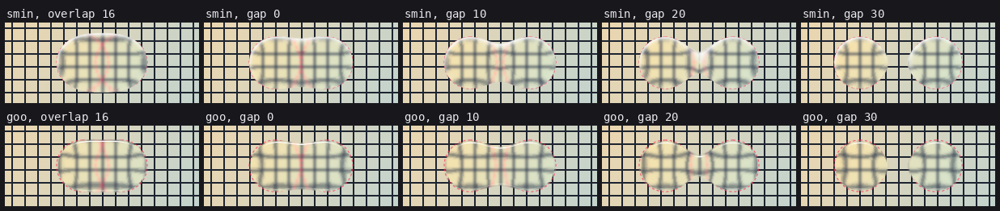
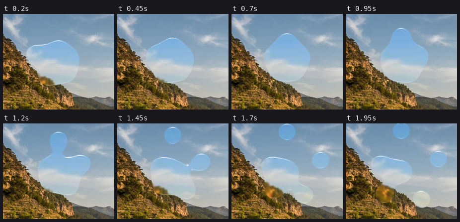
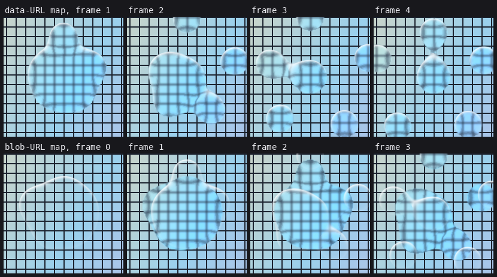
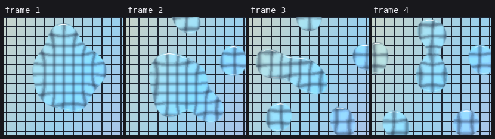
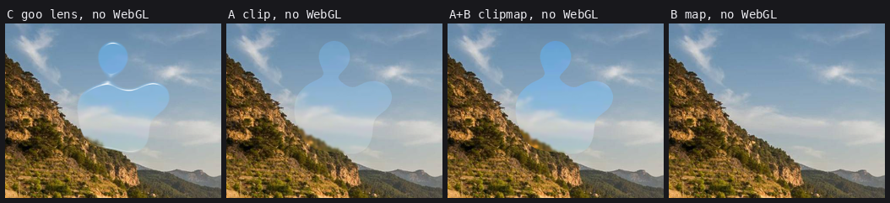
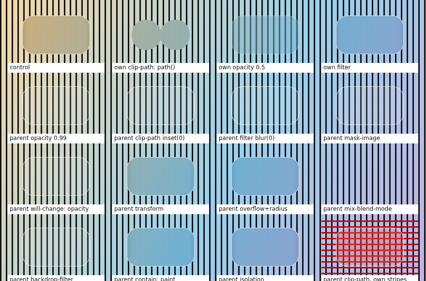

# Spike: glass shapes that merge

Branch `spike/glass-merge` (off `feature/lab-package`). Not for merging — the
prototypes and this note are the deliverable.

**Question.** Can liquefy-ui draw several glass shapes that melt into one another
when they come close — SwiftUI's `GlassEffectContainer(spacing:)`, a smooth-min
union of their outlines — while keeping the refraction that makes them glass,
not a flat fill? This is the basis for a future `GlassMerge` container in
`@liquefy-ui/lab` and for the liquid neck between `DropletMenu`'s trigger and
its droplets.

**Answer.** Yes, on Chromium, with one element whose backdrop filter builds the
whole lens itself (approach C below). It needs no canvas, no WebGL and no
per-frame image, costs well under a millisecond of script per frame, and the
silhouette, the bend and the rim all come out of the same mask so they can
never disagree. Every other engine gets the same container drawn with
`clip-path: path()` and a plain blur (approach A), which is also how the
existing components already degrade there.

## TL;DR

| | Merged neck | Refraction in the neck | Script per frame (n=5) | Needs | Verdict |
|---|---|---|---|---|---|
| **today** — one lensed element per shape | no | — | 0.02 ms | SVG backdrop filter | baseline |
| **A** clip-path from marching squares, blur only | yes, crisp | no (blur only) | ~0.6–1 ms | `clip-path: path()` | **fallback** for WebKit/Gecko |
| **A+B** clip-path + per-frame displacement map | yes, crisp | yes, exact SDF lens | 6–15 ms (readback + PNG) | WebGL + SVG backdrop filter | too slow |
| **B** per-frame map that also carries the mask | yes, soft edge | yes | 6–17 ms (readback + PNG) | WebGL + SVG backdrop filter | too slow |
| **C** lens built inside the SVG filter ("goo lens") | yes | yes | 0.03 ms | SVG backdrop filter | **recommended** |
| **D** per-shape lenses + WebGL neck | yes | no (flat paint) | 0.07 ms | WebGL | reads as a different material |
| **D** per-shape lenses + blurred neck sheet | yes | no (blur only) | ~0.6 ms | `clip-path: path()` | seams at the rims |
| **D** per-shape lenses + goo-lens neck | yes | yes | 0.1 ms | SVG backdrop filter | seams at the rims |



## The shared pieces

Every prototype uses the same field: each shape is a rounded rect SDF (the one in
`packages/core/src/lens.ts` and `renderer.ts`), folded together with the
quadratic smooth minimum

```glsl
float smin(float a, float b) {          // k = 2 * spacing
  float h = max(k - abs(a - b), 0.0) / k;
  return min(a, b) - h * h * k * 0.25;
}
```

so two edges bridge once they are closer than `spacing`, and where they overlap
the concave corner is filled by up to `k / 4`. The lens is exactly the one in
`lens.ts` — displacement `-normal * pow(t, 2)` over a 14 px bezel, capped at
0.88 compression — evaluated on that merged field instead of on one rect.

The scenes are deterministic: `orbit` (64 px circles and 120×48 pills crossing a
container, used for timing), `menu` (a 56 px trigger with 46 px droplets
leaving and returning, used for the pictures) and `pair` (two circles a fixed
gap apart, for neck close-ups). `spacing` is 24 px throughout.

## The approaches

### A — one sheet, clipped to the merged outline

A container-sized element with the ordinary material
(`backdrop-filter: blur() saturate() brightness()`), clipped every frame by
`clip-path: path(evenodd, …)`. The path comes from marching squares over the
smin field on a 4 px grid, restricted to the shapes' bounding box; edge points
are keyed by the grid edge they sit on, so loops chain without orientation
tables and `evenodd` takes care of holes. A WebGL canvas on top draws the rim
from the same field (or, without WebGL, the same path could be stroked).

Chromium clips a backdrop filter by the element's own `clip-path` exactly as
it clips its border radius — see the backdrop-root table below — so the
silhouette is crisp and the frost is real. What is missing is the bend: the
blur is there, but nothing gathers the backdrop toward the rim, so the merged
shape reads as frosted plastic next to the lensed droplets.

### B — a displacement map drawn from the merged field every frame

The obvious way to get the bend back: render the map for the whole container
from the smin field in WebGL (the `lens.ts` shader with `field()` swapped in),
hand it to `feImage`, and either clip with A (`clipmap`) or carry the mask in
the map's blue channel and cut with `feComposite in` (`map`).

It looks right — it *is* the core lens, on the merged shape — but the only door
into an SVG filter is `feImage`, and the only way to put pixels behind it is an
encoded image. `toDataURL('image/png')` runs on the main thread every frame.
Two things worked better than feared: Blink loads `data:` URLs synchronously,
so a frame never shows a missing or stale map (verified frame by frame with
`HeadlessExperimental.beginFrame`); and the map tolerates being rendered at
half resolution. `toBlob` + object URLs is no way out: the image arrives a
frame late, and on a WebGL canvas the call itself blocked the main thread far
longer than `toDataURL` here (~90 ms against 5 ms per frame at 400×300, most
likely waiting on the software GPU for the pixels). Without WebGL the map is
missing altogether, which shifts the whole backdrop by half the scale
(`clipmap`) or erases the glass (`map`).

### C — the lens built inside the filter ("goo lens")

Instead of handing the filter a map, let the filter build one. The container's
backdrop filter is a single SVG filter:

1. one `feImage` per shape, each a static vector sprite of that rounded rect
   (`data:image/svg+xml`, loaded once), positioned with its `x`/`y`
   attributes — the only thing written per frame;
2. `feMerge` → `feGaussianBlur(σ = spacing / 1.35)` → a steep `feColorMatrix`
   threshold: the classic metaball/goo union, as a crisp alpha mask. Sprites
   are grown by a precomputed amount so a lone circle keeps its size after the
   blur-and-threshold;
3. the mask blurred again by half the bezel is a height field; four
   `feOffset`s and two arithmetic `feComposite`s take its central differences.
   The arithmetic runs on **alpha**, because Chromium clamps premultiplied
   colour to alpha after an arithmetic composite and a signed value offset by
   0.5 would lose its top half otherwise; two colour matrices then move the
   results into R and G;
4. `feDisplacementMap` bends the backdrop with that map, the usual 0.6 px
   softening and saturation follow, and `feComposite in` cuts it to the mask;
5. two `feSpecularLighting` passes over a lightly blurred copy of the mask
   give the bright lip on top and the faint shade line below, cut to the same
   mask.

Because the output is transparent outside the mask, the element can be any
size: Chromium composites a backdrop filter's result over the untouched
backdrop, so transparent pixels simply show the page. The derivative of a
blurred edge is a bump that peaks at the rim and dies off inward — roughly
the shape of `pow(t, 2)` in `lens.ts` — so the bend looks like the existing lens,
and it is continuous through the neck because the neck is just more mask.

Limits found on the way:

- Skia runs any blur above σ 4 at reduced resolution and upsamples it, so a
  derivative of a large blur can stair-step. At these sizes it did not show;
  splitting the height blur into passes of σ ≤ 4 (`?passes=`) removes it if it
  ever does.
- The silhouette is a Gaussian metaball, not the SDF: rounded-rect corners
  soften by about σ and the neck is fuller than smin's for the same spacing.
  The sprite growth keeps a lone circle exactly its size, but it is one
  number per shape, worked out for the corner radius: a pill's flat sides,
  which the blur does not erode, end up about that much (≈6 px at σ 18) too
  far out. Growing corners and sides separately would fix it.
- Sprites are axis-aligned. Moving and uniform scaling are attribute writes;
  a new aspect ratio or a rotated stretch needs a new sprite, which loads
  synchronously from a `data:` URL but is not free (see the neck results).

### D — keep per-shape lenses, add only the neck

Three variants keep today's lensed droplets and add a layer for the neck
only: painted in WebGL on top of them (`bridge`), a blur-only sheet behind them
clipped to the neck region with A's marching squares (`bridgeclip`), or C's
filter behind them with the hard union of the shapes cut out (`bridgegoo`).
All three are light on the main thread, and none of them can look like one
body: each droplet's own rim and its own lens — bending
toward *its* centre — still run straight across the place where the neck
joins. The painted neck also does not refract or blur, so it reads as a
different material. D is a dead end for a seamless neck.

## Results

### Frame cost

**Method.** Each frame is serialised: the scene changes in `requestAnimationFrame`,
then the page waits for that frame's swap (`chrome.gpuBenchmarking`'s swap
listener) before starting the next. One sample is therefore the whole pipeline
for one frame — main thread, commit, raster and the GPU — with nothing
overlapped. A Chromium trace of the same frames gives the renderer main
thread's busy time; `performance.now()` around the update gives the script.
Chromium 151 on SwiftShader, DPR 1, 24 frames per configuration, two full runs;
each cell is the lower of the two medians (the box was shared with other work,
and noise only ever adds).

Time per serialised frame on the **software GPU**, ms — this ranks GPU load, it
is not what real hardware will show:

| | 400×300 n=2 | n=5 | n=10 | 800×500 n=2 | n=5 | n=10 |
|---|--:|--:|--:|--:|--:|--:|
| today: lens per shape | 12 | 24 | 40 | 13 | 23 | 41 |
| A clip-path, blur | 34 | 60 | 84 | 82 | 148 | 226 |
| A+B clip + map | 46 | 84 | 113 | 105 | 206 | 467 |
| B map with mask | 103 | 118 | 149 | 304 | 382 | 758 |
| C goo lens | 57 | 129 | 149 | 93 | 300 | 330 |
| D WebGL neck | 30 | 57 | 100 | 70 | 140 | 249 |
| D blurred neck | 24 | 48 | 70 | 38 | 68 | 91 |
| D goo-lens neck | 70 | 168 | 195 | 103 | 312 | 394 |

Renderer **main thread** per frame (real CPU work), ms, and the script alone:

| | 400×300 n=2 | n=5 | n=10 | 800×500 n=2 | n=5 | n=10 | script, n=5 (400×300 / 800×500) |
|---|--:|--:|--:|--:|--:|--:|--:|
| today: lens per shape | 0.6 | 0.7 | 0.9 | 0.8 | 0.7 | 1.0 | 0.02 / 0.03 |
| A clip-path, blur | 1.1 | 1.8 | 1.6 | 1.2 | 2.0 | 2.4 | 0.59 / 0.94 |
| A+B clip + map | 5.3 | 7.5 | 10.9 | 11.6 | 15.6 | 24.5 | 6.37 / 14.53 |
| B map with mask | 5.2 | 6.4 | 9.9 | 10.9 | 14.4 | 34.5 | 5.96 / 16.54 |
| C goo lens | 0.8 | 1.2 | 1.7 | 1.0 | 1.2 | 2.0 | 0.03 / 0.03 |
| D WebGL neck | 0.7 | 0.8 | 0.9 | 0.8 | 0.9 | 1.1 | 0.07 / 0.05 |
| D blurred neck | 1.0 | 1.4 | 1.9 | 1.1 | 1.8 | 2.7 | 0.63 / 0.97 |
| D goo-lens neck | 1.3 | 2.0 | 2.6 | 1.8 | 1.9 | 3.0 | 0.10 / 0.12 |

What the numbers say:

- **Main thread.** C costs about half a millisecond more than today — Blink
  rebuilding the filter after the `x`/`y` writes — and is flat in the number of
  shapes. A pays for marching squares in script (0.6–1 ms at n=5 on this box).
  B pays for reading the map back from WebGL and encoding it as PNG, which is
  4–9 ms for a 200×150 map and 11–37 ms for 400×250, growing with the shape
  count (a busier map compresses worse). B is out on this alone.
- **GPU.** Today's per-shape lenses are cheapest because each one filters only
  its own 64 px square. Every merged approach filters the region the shapes
  span. C is the heaviest per pixel (about 25 primitives, two of them large
  blurs, two lighting passes), roughly 5× today's cost on SwiftShader for five
  shapes.
- **C's cost follows the shapes, not the element.** Skia bounds every
  primitive by its inputs, so the whole chain only runs around the sprites
  (their union plus three sigmas). The `menu` scene — six shapes clustered in
  the middle of an 800×500 container — costs 69 ms against 300 ms for five
  shapes spread over it, and shrinking the element to the shapes' bounding box
  changed little (69 → 57 ms). A is the opposite: a CSS `blur()` filters the
  whole element whatever its `clip-path`, so fitting the sheet to the shapes
  matters more there (154 → 125 ms).
- **Where C's GPU time goes** (400×300, n=5): the two lighting passes for the
  rim are about a third (129 → 87 ms without them); splitting the height
  blur into σ ≤ 4 passes to dodge Skia's downsampling nearly tripled it
  (362 ms), so it stays one pass. A's WebGL rim canvas is half of A's cost
  here (60 → 29 ms without it); a stroked SVG path would do the same job.

PNG encode alone, from a 2D canvas with no GPU readback (`encode.html`):

| container | full-size map | half | quarter |
|---|--:|--:|--:|
| 400×300 | 3.9 ms | 1.9 ms | 1.2 ms |
| 800×500 | 9.3 ms | 3.2 ms | 2.0 ms |
| 1200×800 | 20.7 ms | 6.1 ms | 2.8 ms |

The in-page figures above are higher than these because the map is drawn in
WebGL and `toDataURL` on a WebGL canvas reads the pixels back first.

### The neck

Two 64 px circles 6 px apart over a grid, enlarged 2×:



Only A+B and C bend the backdrop through the neck; A frosts it flat, and every
D variant keeps each circle's own rim and its own bend running across the
join. C's lit lip follows the merged outline along the top.

The same pair pulled apart, with the true circles dashed in red. `spacing` is
24 px for both:



Both let go between 20 and 30 px. The smin neck thins before it snaps; the goo
neck stays fuller for longer and is boxier while the shapes overlap. The
silhouette of a lone shape matches in both (the dashed outlines sit on the
glass edge), thanks to the sprite growth in C.

C on the `menu` scene, droplets budding off a trigger and returning:



**Map updates and timing (B).** Frames captured one at a time with
`HeadlessExperimental.beginFrame`, the scene jumping between frames so a lag
would show. With `data:` URLs the glass is where the rim (drawn the same frame
in WebGL) is, every frame. With `blob:` URLs the first frame has no glass at
all and every later one shows the previous frame's map:



**Stretched and rotated shapes (C).** `DropletMenu` stretches each droplet
along its direction of travel, which an axis-aligned sprite cannot follow.
Rebuilding each sprite every frame as a rotated, stretched `data:` SVG works —
it loads synchronously, so it is always current:



but each new sprite is a new SVG image document, about 0.7 ms of script apiece
here (4.5 ms for six), so a real implementation should cache sprites by
quantised stretch and angle. The alternative, `feImage href="#element"` on a
live SVG shape, renders nothing inside a backdrop filter in Chromium 151.

### Without WebGL



C is unchanged — it never used WebGL. A loses its rim and becomes a pale
cut-out; stroking the clip path instead of drawing the rim in WebGL fixes
that. A+B with no map is worse than no lens: a missing `feImage` reads as
transparent, i.e. −0.5 in both channels, so the whole backdrop shifts by half
the displacement scale (measured: exactly 6 px left and up). B takes its mask
from the map, so the glass vanishes.

## How to run the prototypes

```bash
python3 -m http.server 8765 --bind 127.0.0.1   # from the repository root
# then open http://127.0.0.1:8765/docs/spikes/glass-merge/index.html?mode=goo&n=5
```

`index.html` + `proto.js` hold every approach behind `?mode=`; the other query
parameters (`n`, `w`, `h`, `scene=orbit|menu|pair`, `spacing`, `bezel`,
`mapScale`, `grid`, `fit=1`, `rim=0`, `nogl=1`, `bg=grid`, `outline=1`, `t=`
to freeze a frame) are documented at the top of `proto.js`.
`bench.mjs` drives them in Chromium (`shots`, `bench`, `trace`, `encode`);
`backdrop-root.html` is the backdrop-root probe and `encode.html` the encode
cost probe.

## Backdrop roots: what may sit above the glass

A backdrop filter only sees what is painted inside its *backdrop root* — the
nearest ancestor with a filter, opacity below 1, a mask, a clip-path, a
backdrop filter, or `will-change` naming one of those. Probed in Chrome 151
(`backdrop-root.html`, 6 px blur over hard stripes):



| On the glass element itself | Result |
|---|---|
| `clip-path: path()` | clips the frosted backdrop to the path — approach A relies on this |
| `opacity: 0.5` | fades the glass, blur intact |
| `filter: url()` | fine |

| On an ancestor | Glass still sees the page? |
|---|---|
| `opacity: 0.99` | **no** — blurs nothing |
| `clip-path: inset(0)` | **no** |
| `filter: blur(0)` | **no** |
| `mask-image` | **no** |
| `will-change: opacity` | **no** (even with opacity 1) |
| `backdrop-filter` | **no** |
| `transform` / `will-change: transform` | yes |
| `overflow: hidden` + `border-radius` | yes, and clips |
| `mix-blend-mode` | yes in Chromium 151, although the spec lists it as a trigger |
| `contain: paint`, `isolation: isolate` | yes |

So a merge surface may sit under any `transform`, but under nothing from the
first group, and fades belong on the glass element, never on a wrapper. That rules out the easy way to fade a portal or popup that holds
glass, and it is why approach A clips the glass element itself rather than a
parent. It also means the shapes of a merge container cannot each be their own
backdrop-filtered child of a clipped parent: under a clipped parent they would
see only the parent.

## Recommendation

Build `GlassMerge` on approach C, with approach A as its fallback, both driven
by one list of shapes:

- **Chromium (`isLensSupported()`)** — the filter-built lens. Script per frame
  is a handful of attribute writes and the main thread stays within half a
  millisecond of today's; everything else is about 25 filter primitives over
  the area the shapes span, which is the cost to verify on real hardware (see
  below). No WebGL is involved, so the renderer's context limit and lost
  contexts do not apply, and the rim cannot drift from the silhouette.
- **WebKit, Gecko, or `prefers-reduced-transparency`** — one sheet with the
  ordinary blurred material clipped by `clip-path: path()` from marching
  squares over the smin field, and the rim as a stroke of the same path. This
  is roughly what the existing components show there already (frost without
  the bend), but merged.
- **Not** a per-frame displacement map (B): reading the map back and encoding
  it as PNG alone took 4–37 ms of main thread per frame, before the browser
  decodes it again.
- **Not** per-shape lenses with a neck added (D): the seam where each shape's
  own rim crosses the neck is the thing a merge is supposed to remove.

For `DropletMenu` this means the menu's glass — trigger and droplets together —
becomes one `GlassMerge` surface, the trigger included so there is never a
hand-over between two kinds of glass, with the trigger and the droplets as
transparent, focusable buttons laid over it. `DropletChoreography`
already computes every droplet's centre and scale per frame, which is exactly
the `setShapes` call below. The surface has to live outside any faded or
clipped popup wrapper (backdrop roots, above).

### API sketch

Framework-free, next to `attachLiquidLens` in `@liquefy-ui/core`:

```ts
export type GlassMergeShape = {
  /** Centre, in px from the container's top-left. */
  x: number
  y: number
  width: number
  height: number
  /** Corner radius; `min(width, height) / 2` makes a circle or a pill. */
  radius: number
  /** Squash and stretch along `angle` (degrees); 1 is none. DropletMenu's travel stretch. */
  stretch?: number
  angle?: number
}

export type GlassMergeOptions = {
  /** Largest gap, in px, that still bridges. SwiftUI's `spacing`. */
  spacing?: number // 16
  bezel?: number // as LensFilterOptions
  strength?: number // as LensFilterOptions
  tint?: string
  respectReducedTransparency?: boolean
}

export type GlassMergeController = {
  /** Which renderer was chosen: the filter-built lens, or the clipped fallback. */
  readonly mode: 'lens' | 'outline'
  /** Cheap enough to call every animation frame. */
  setShapes(shapes: readonly GlassMergeShape[]): void
  destroy(): void
}

export const attachGlassMerge: (
  element: HTMLElement,
  options?: GlassMergeOptions,
) => GlassMergeController
```

In `@liquefy-ui/lab`, a component that owns the surface and hands out the
controller, so motion code can drive it without React renders:

```tsx
export type GlassMergeProps = LiquidStyleProps & {
  spacing?: number
  tint?: string
  /** Shapes for a static layout; animated callers use the handle instead. */
  shapes?: GlassMergeShape[]
  children?: ReactNode // interactive content, laid over the glass
  className?: string
  style?: CSSProperties
}

export type GlassMergeHandle = Pick<GlassMergeController, 'setShapes' | 'mode'>

// <GlassMerge ref={mergeRef} spacing={16}>…buttons…</GlassMerge>
// inside DropletMenu's paint():
//   mergeRef.current?.setShapes([trigger, ...droplets])
```

A declarative `GlassMerge.Shape` child that measures itself (ResizeObserver plus
the transform its parent animates) can come later; the imperative handle is
what both `DropletMenu` and any physics-driven demo need first.

Notes for the implementation:

- The surface has no `background`, `border` or `box-shadow` of its own — they
  would be rectangles. The veil and the rim come out of the filter, and so
  would a drop shadow (the mask blurred and offset, kept outside the mask),
  which this spike did not try.
- `spacing` maps to the metaball blur as σ ≈ spacing / 1.35 (where two
  straight edges stop bridging); sprite growth is computed once per radius
  and σ, as `gooInflation()` in `proto.js` does.
- Sprites are cached by size, and for stretched shapes by quantised stretch
  and angle, so a steady animation stops creating images after a few frames.
- The pointer-driven extras of `LiquidRenderer` (glow, ripple, sparkle,
  jelly wobble) are not in the filter. They can come back as a WebGL overlay
  drawn from the smin field, accepting that it will not match the metaball
  outline to the pixel, or be left out of merge surfaces.
- Mount and fade the surface itself; never put it under an element with
  `opacity`, `filter`, `clip-path`, `mask` or `will-change: opacity`.

## What this machine cannot tell us

All numbers come from Chromium 151 on SwiftShader (a CPU emulating the GPU) on a
two-core box shared with other work. Script and main-thread figures are real
CPU work and transfer roughly; GPU figures only rank the approaches.

To check on real hardware before building it:

- **GPU time of the filter-built lens** at realistic sizes (a 300×300 menu, a
  full-width 800×120 toolbar) and at device pixel ratio 2, on an integrated
  GPU (Intel/AMD laptop) and on Apple silicon in Chrome. It is about 25 filter
  primitives over the container, two of them large blurs; a phone-class GPU at
  DPR 3 is the case most likely to drop frames.
- **Whether Chromium re-rasterises anything besides the filter** when only an
  `feImage`'s `x` changes (DevTools' paint flashing / layer borders), and
  whether the filter is rebuilt from scratch every frame on the main thread.
- **Skia's reduced-resolution blur** at DPR 2 — the stair-stepping it can cause
  in the derived map did not show here.
- **Safari**: that `-webkit-backdrop-filter` honours `clip-path: path()` on the
  same element (the fallback depends on it), how expensive a per-frame
  `clip-path` change is there, and that the sheet without an SVG lens still
  looks acceptable next to the plain droplets. Firefox the same.
- **Android Chrome**: SVG backdrop filters are on, but the GPU budget is the
  smallest.
